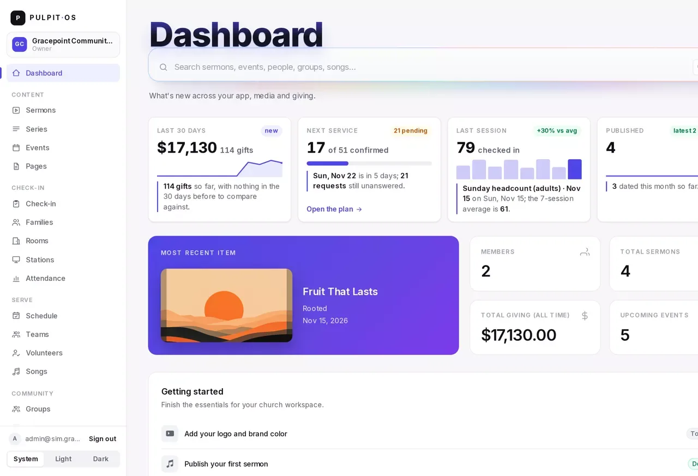
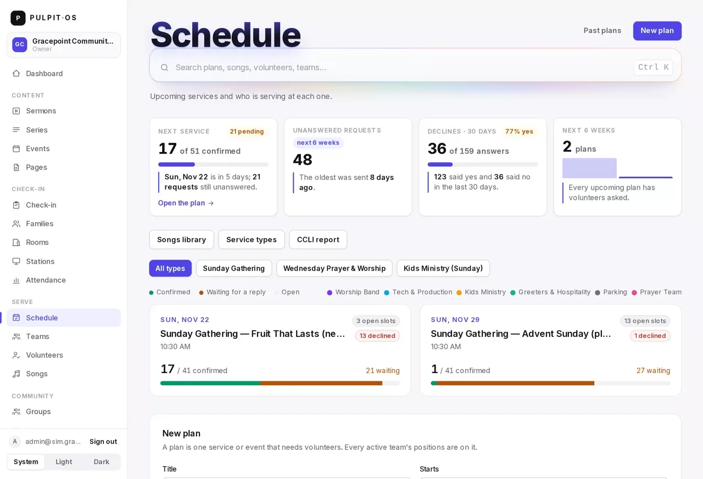
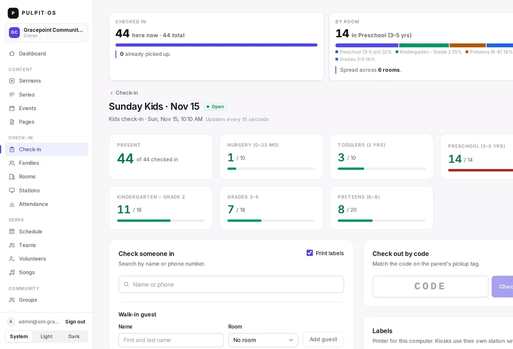
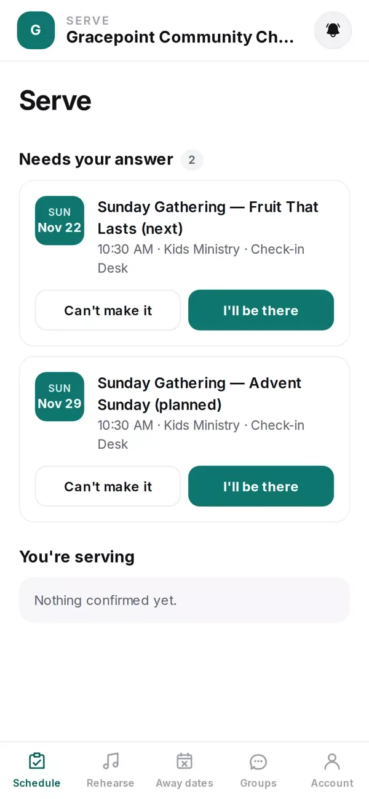
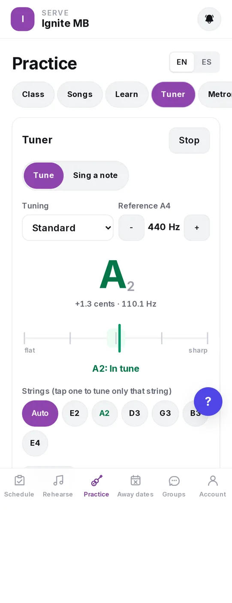
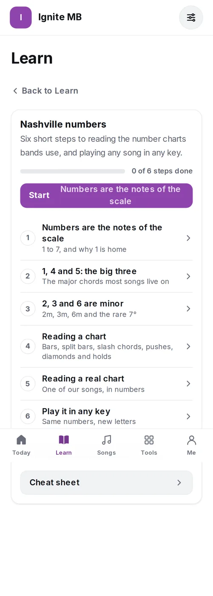
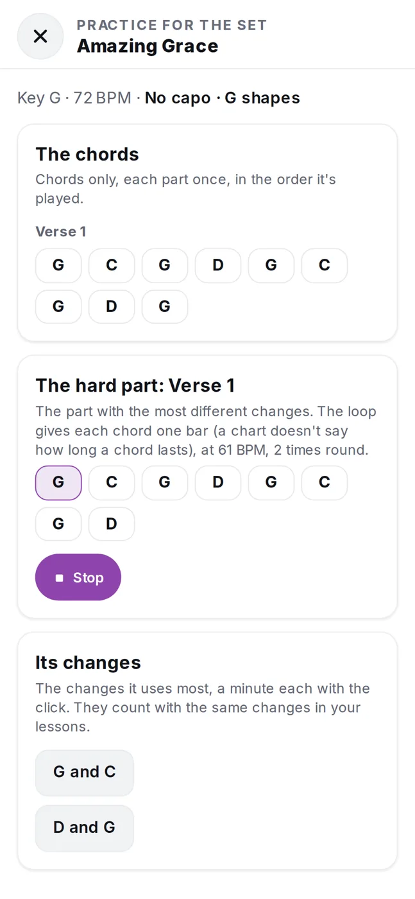

# Hi, I'm Aaron Neece

Full-stack developer in Myrtle Beach, SC. I run [BuildBridge](https://buildbridge.agency), a one-person software agency, and take remote contract work.

I build web apps, integrations and AI-agent automations in TypeScript, React, Next.js, Node, Python and C#, with Postgres/Supabase underneath and real test suites on top. I direct AI coding agents under strict test and review gates, so I ship in whatever stack a client uses.

## In development: Pulpit OS

One platform for a church's whole week: sermons and content, giving, groups, volunteer scheduling, kids check-in, a member app, and a bilingual (EN/ES) worship-practice app with a tuner, lessons and coaching. Next.js, React, TypeScript, Supabase. The source is private while I finish it; the staff screens below show a simulated church with fictional data.

**Staff side**

| Dashboard | Volunteer schedule | Kids check-in |
|---|---|---|
|  |  |  |

**Phone side: volunteer app and worship practice**

| Serve requests | Tuner | Nashville numbers course | Practice for the set |
|---|---|---|---|
|  |  |  |  |

## Code you can read

| Repo | What it is | Stack |
|---|---|---|
| [lineboard](https://github.com/nomadd3v/lineboard) | Kitchen display system that runs on any screen: Windows, Android, Fire TV and the browser. 769 tests | C#/.NET 8, Avalonia |
| [rezd-oss](https://github.com/nomadd3v/rezd-oss) | Port, device and identity lease daemon for fleets of AI coding agents | Python, FastAPI |
| [pixelboard-signage](https://github.com/nomadd3v/pixelboard-signage) | Canva-style editor for digital signage with validator-guarded edits and rollback | Node, Express, Fabric.js |
| [menu-extract](https://github.com/nomadd3v/menu-extract) | Turns restaurant menus (PDF, image, HTML, DOCX) into a validated JSON menu model | TypeScript |
| [anthropic-batch-governor](https://github.com/nomadd3v/anthropic-batch-governor) | Spend gate, audit ledger and cost calculator in front of Anthropic batch calls | Python, FastAPI |
| [safe-area](https://github.com/nomadd3v/safe-area) | Notch and status-bar inset detection for PWAs and Capacitor shells | TypeScript |
| [ocr-kit](https://github.com/nomadd3v/ocr-kit) | Turns an old Android phone into a free on-device OCR server for AI agents | Kotlin |

## Live work

- [Ignite Seminary LMS](https://seminary.ignitemb.com): custom learning platform with courses, grading, certificates, applications and recurring tuition billing (Next.js 16, React 19, Supabase).
- [HapsLocal](https://hapslocal.com): a live-music calendar for the Grand Strand that I built and run.
- Restaurant tech: online ordering with card checkout, multi-location reporting and menu-to-deploy tooling (private client work).

## Contact

- Site: [buildbridge.agency](https://buildbridge.agency)
- Email: hello@buildbridge.agency
- LinkedIn: [aaron-neece](https://www.linkedin.com/in/aaron-neece-5661453b8)
